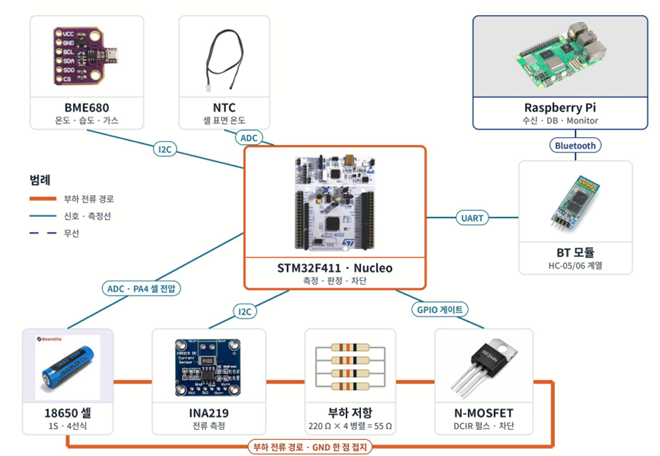
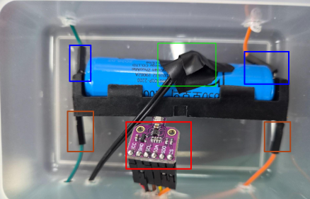
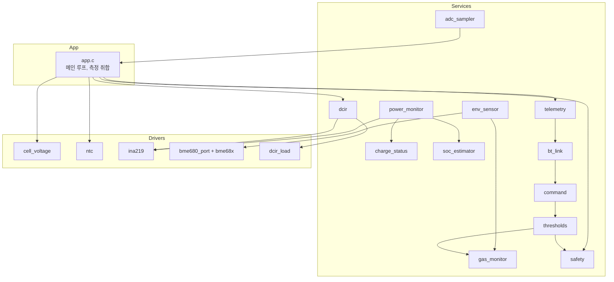

# Battery Monitor (STM32F411)

18650 리튬이온 배터리 1셀을 감시하는 STM32 펌웨어입니다. 셀 전압, 전류, 배터리 온도, 케이스 내부 환경(온도/습도/기압/가스)을 측정하고, 내부 저항(DCIR)을 주기적으로 스스로 측정합니다. 측정값은 블루투스로 서버(라즈베리파이)에 보내고, 서버는 안전 임계값을 원격으로 바꿀 수 있습니다.

> 이 저장소에는 STM32 펌웨어만 있습니다. 데이터를 받아 DB에 저장하는 서버 코드는 포함되어 있지 않습니다.

## 주요 기능

| 기능 | 내용 |
|---|---|
| 셀 전압 | 켈빈(4선) Sense 선 → 분압 → ADC(PA4), VREFINT로 VDDA 보정 |
| 전류 / 충전 상태 | INA219(I2C) 션트 전류, 충전 +/방전 −, 전류로 충전 중/완충 추정 |
| 잔량(SOC) | 전류 적분(사다리꼴) + 완충 시 100% 리셋 + 휴지 시 OCV 보정 |
| 배터리 온도 | NTC 10kΩ(B3950) 분압 → ADC(PA1) |
| 환경 / 가스 | BME680(I2C): 온도, 습도, 기압, 가스 저항 |
| 가스 이상 감지 | 가스 저항의 **기준값 대비 감소율**로 경고/경보 판정 |
| 내부 저항(DCIR) | 100ms 부하 펄스(TIM3 원펄스 + MOSFET)로 5분마다 자동 측정 |
| 안전 판정 | 저전압/과전압/과열/가스 → OK / WARN / ALARM, 상태 LED 표시 |
| 통신 | 블루투스(USART1)로 `$BAT`, `$DCIR` 패킷 송신, `$CMD`로 임계값 변경 수신 |

## 하드웨어

### 구성 부품

| 부품 | 용도 |
|---|---|
| NUCLEO-F411RE (STM32F411RE, 100MHz) | 메인 MCU |
| 18650 리튬이온 1셀 (ZM18650P-2200, 공칭 2200mAh) + 1구 홀더 | 감시 대상 배터리 |
| INA219 모듈 (션트 R100) | 전류, 버스 전압 |
| BME680 모듈 | 케이스 내부 온도/습도/기압/가스 |
| NTC 10kΩ B3950 + 10kΩ | 배터리 표면 온도 |
| IRLZ44N + 220Ω × 4 병렬(55Ω) | DCIR 측정용 부하 (약 72mA) |
| 10kΩ + 10kΩ 분압 + 100nF | 셀 전압을 ADC 범위로 낮춤 |
| 블루투스 모듈 HC-05/06 계열 (UART 9600 baud) | 라즈베리파이 서버와 통신 |
| Raspberry Pi | 수신, DB 저장, 모니터링 (이 저장소에 코드 없음) |

### 핀 배치

| 핀 | 기능 | 연결 |
|---|---|---|
| PA1 | ADC1_IN1 | NTC 분압 중간점 |
| PA4 | ADC1_IN4 | 셀 전압 분압 중간점 (Sense+) |
| PA6 | TIM3_CH1 | DCIR 부하 MOSFET 게이트 (220Ω 직렬, 게이트-소스 10kΩ 풀다운) |
| PB8 / PB9 | I2C1 SCL / SDA (400kHz) | INA219(0x40), BME680(0x76) |
| PA9 / PA10 | USART1 TX / RX (9600) | 블루투스 모듈 |
| PA2 / PA3 | USART2 TX / RX (115200) | 디버그 로그 (ST-Link 가상 COM 포트) |
| PA5 | GPIO 출력 | 상태 LED (LD2) |
| PC13 | GPIO 입력 | B1 버튼 (DCIR 수동 시작) |

### 시스템 구성도



- 주황색: 부하 전류 경로 (셀 → INA219 → 부하 저항 → MOSFET → 셀 −, GND는 셀 − 한 점에서 접지)
- 청록색: 신호·측정선 (I2C, ADC, UART, GPIO 게이트)
- 점선: 무선 (블루투스, 라즈베리파이에서 수신·DB 저장·모니터링)

### 케이스 내부



- 파란 상자: 홀더 구리판 접점 가까이에 납땜한 Sense 선 (+/−)
- 주황 상자: 홀더 아래 꺾인 판에 납땜한 Force 선 (+/−)
- 초록 상자: 셀 표면에 붙인 NTC
- 빨간 상자: 케이스 안 공기를 재는 BME680

<!-- 상세 회로도가 생기면 docs/images/ 에 넣고 여기에 추가하세요 -->
<!--  -->

### 배선 시 주의 (측정 정확도에 중요)

DCIR처럼 mV 단위 전압 변화를 재므로, 부하 전류가 흐르는 길과 측정 기준 GND를 분리해야 합니다.

```
STM32 GND ─┬─ 신호 GND 줄 (블루투스, NTC, INA219, BME680, PA4 분압/커패시터)
           └─ Sense− 선 ──┐
                         홀더 − 구리판 (셀 −)   ← 두 GND가 만나는 유일한 점
부하 GND 줄 ── Force− 선 ─┘
  └─ MOSFET 소스
```

- 셀 +/−는 **Sense 선**(측정용)과 **Force 선**(전류용)을 따로 납땜합니다(켈빈 연결).
- STM32 GND와 부하 GND(MOSFET 소스)를 빵판에서 직접 잇지 않습니다. 이으면 부하 전류의 전압 강하가 측정에 섞여 DCIR이 크게 부풀려집니다.
- MOSFET 게이트-소스 풀다운은 10kΩ처럼 게이트 직렬 저항(220Ω)보다 훨씬 커야 MOSFET이 완전히 켜집니다.

## 소프트웨어 구조

### 계층



- **Drivers**: 하드웨어를 직접 다루는 계층 (센서, 부하 펄스)
- **Services**: 주기 측정, 판정, 통신 같은 기능 단위
- **App**: 모듈들을 초기화하고 주기적으로 실행하며 결과를 모아 내보냄

### 디렉터리

```
├── App/
│   ├── App/        app.c(메인 루프), config.h(모든 설정값), measurement.h(측정 스냅샷)
│   ├── Drivers/    cell_voltage, ntc, ina219, bme680_port, dcir_load, bme68x/(Bosch 드라이버)
│   └── Services/   adc_sampler, env_sensor, gas_monitor, power_monitor, charge_status,
│                   soc_estimator, safety, thresholds, dcir, telemetry, bt_link, command, log
├── Core/           CubeMX 생성 코드 (main.c, 주변장치 초기화)
├── Drivers/        STM32 HAL, CMSIS
├── cmake/          툴체인 파일
├── Kcci_Miniproject_Battery_Monitor.ioc   CubeMX 프로젝트
└── CMakeLists.txt
```

<!-- 프로젝트 구조도 이미지가 있으면 docs/images/ 에 넣고 아래 경로를 맞추세요 -->
<!--  -->

직접 작성한 코드는 모두 `App/` 아래에 있어서 CubeMX로 다시 생성해도 지워지지 않습니다. 각 `.c` 파일 첫 줄에 모듈의 역할과 용도를 주석으로 적어 두었습니다.

### 모듈 목록

| 모듈 | 폴더 | 역할 |
|---|---|---|
| `app` | App | 모듈 초기화와 주기 실행, 측정값 취합, 텔레메트리/로그/LED, B1 버튼, 블루투스 수신 연결 |
| `config.h` | App | 모든 설정값 (주기, 임계값 기본값, 부품 사양) |
| `measurement.h` | App | 한 주기의 측정 스냅샷 구조체 |
| `cell_voltage` | Drivers | ADC raw → 셀 전압(mV, µV), 분압비 환산 |
| `ntc` | Drivers | ADC raw → 배터리 온도(0.1°C), Beta 식, 단선/단락 판정 |
| `ina219` | Drivers | INA219 설정, 션트 전압 → 전류, 버스 전압, I2C 오류 복구 |
| `bme680_port` | Drivers | Bosch 드라이버를 I2C1에 연결, forced mode 측정 시작/완료 확인, 재탐색 |
| `bme68x/` | Drivers | Bosch BME68x SensorAPI (외부 코드) |
| `dcir_load` | Drivers | TIM3 원펄스로 부하 펄스 생성, 쉬는 동안 PA6 Low 고정 |
| `adc_sampler` | Services | ADC DMA 스캔(NTC, 셀, VREFINT), 16회 평균, VDDA 계산, DCIR용 즉시 변환 |
| `env_sensor` | Services | BME680 2초 주기 비동기 측정, 연결 상태 로그 |
| `gas_monitor` | Services | 가스 기준값 추적, 감소율로 경고/경보 판정 |
| `power_monitor` | Services | INA219 100ms 주기 읽기, 미검출 시 자동 재탐색 |
| `charge_status` | Services | 전류와 셀 전압으로 충전 상태 추정 (0 미연결, 1 충전 중, 2 완충) |
| `soc_estimator` | Services | 전류 적분 SOC, 완충 시 100% 리셋, 휴지 시 OCV 보정 |
| `battery_soc` | Services | OCV 테이블 (셀 전압 → 잔량) |
| `safety` | Services | 전압/온도/가스 판정 → OK / WARN / ALARM과 원인 플래그 |
| `thresholds` | Services | 서버에서 바꿀 수 있는 임계값 8개, 범위와 순서 검증 |
| `dcir` | Services | DCIR 상태머신 (인터록, 휴지, 반복 측정, 평균/표준편차, 5분 자동) |
| `telemetry` | Services | `$BAT`, `$DCIR` 패킷 생성과 체크섬 |
| `bt_link` | Services | USART1 링 버퍼 송신(인터럽트), 줄 단위 수신 |
| `command` | Services | `$CMD,id,SET,key,value` 해석 |
| `log` | Services | printf → USART2 디버그 로그 |

### 메인 루프 주기

| 작업 | 주기 |
|---|---|
| ADC 샘플 (16회 평균) | 10ms (평균은 약 160ms마다) |
| INA219 읽기, SOC 적분 | 100ms |
| 측정 취합 + 안전 판정 | 100ms |
| BME680 측정 | 2초 |
| `$BAT` 송신, 디버그 로그 | 1초 |
| DCIR 자동 측정 | 5분 |

## 동작 상세

### 안전 판정
| 항목 | 경고 | 경보 |
|---|---|---|
| 저전압 | ≤ 3300mV | ≤ 3000mV |
| 과전압 | ≥ 4250mV | ≥ 4350mV |
| 배터리 과열 | ≥ 45.0°C | ≥ 60.0°C |
| 가스(기준 대비 감소) | ≥ 30% | ≥ 50% |

- LED: 정상 1초 점멸, 경고 0.25초 점멸, 경보 상시 점등
- 임계값은 서버 명령(`$CMD`)으로 바꿀 수 있고, 재부팅하면 기본값으로 돌아갑니다.

### 가스 이상 감지
BME680 가스 저항은 개체, 온도, 습도마다 절대값이 크게 달라 고정 임계값을 쓸 수 없습니다. 그래서 기준 저항을 추적하고 그 대비 감소율로 판정합니다.
- 기준값: 저항이 오르는 방향(공기가 깨끗해짐)은 빠르게(1/8), 내려가는 방향은 매우 느리게(1/512) 따라가고, 이상 상태에서는 멈춥니다.
- 부팅 후 안정화 구간(`GAS_WARMUP_MS`) 동안은 판정하지 않습니다.
- 같은 판정이 2회 연속 나와야 단계가 바뀌고, 내려올 때 5% 히스테리시스가 있습니다.

### 내부 저항(DCIR)
```
DCIR = (V0 − V1) / |I1 − I0|
```
1. 인터록 확인: INA219 응답, 충전 중 아님, 경보 없음, 휴지 상태(|I| ≤ 20mA), 셀 ≥ 3.3V
2. 30초 휴지
3. 반복 20회: V0·I0 64회 평균 → 100ms 부하 펄스 → 80~98ms 구간에서 V1·I1 평균 → 3초 회복
4. 평균과 표준편차를 계산해 `$DCIR` 전송

부하 저항값은 계산에 쓰지 않고 실측 전류를 사용합니다. 펄스는 TIM3 원펄스로 하드웨어가 정확히 100ms 뒤에 끄고, 쉬는 동안 PA6는 GPIO Low로 고정됩니다. 1세트는 약 90초 걸립니다.

### 충전 상태 / SOC
- 충전 상태는 INA219 전류로 추정합니다: 0 미연결, 1 충전 중(≥ 100mA), 2 완충(충전 종료 + 셀 ≥ 4150mV).
- SOC는 전류를 적분해 추적하고, 완충 시 100%로, 30분 이상 휴지 시 OCV 테이블로 보정합니다.

## 통신 프로토콜

블루투스(USART1, 9600 baud)로 한 줄 텍스트를 주고받습니다. 값은 모두 정수이고, 무효 값은 `NA`입니다.

### `$BAT` 상태 패킷 (1초마다)
```
$BAT,id,packet_index,tick,cell_mv,cell_temp,air_temp,air_humi,air_pres,gas,vbus_mv,current_ma,charge_state,soc_permil*CC
```

| 필드 | 단위 |
|---|---|
| `id` | 장치 ID |
| `packet_index` | 패킷 순번 (재부팅 시 0) |
| `tick` | 부팅 후 ms |
| `cell_mv` | 셀 전압 mV |
| `cell_temp` | 배터리 온도 0.1°C |
| `air_temp` / `air_humi` / `air_pres` | 0.1°C / 0.1%RH / 0.1hPa |
| `gas` | 가스 저항 Ω |
| `vbus_mv` / `current_ma` | INA219 버스 전압 mV / 전류 mA (충전 +, 방전 −) |
| `charge_state` | 0 미연결, 1 충전 중, 2 완충(추정) |
| `soc_permil` | 잔량 0~1000 (0.1%) |

### `$DCIR` 측정 결과 (측정 1세트 완료 시)
```
$DCIR,id,tick,v0_uv,v1_uv,i0_ua,i1_ua,dcir_uohm,dcir_std_uohm,repeat_n,vcell_mv,temp_mc*CC
```
전압은 µV, 전류는 µA, 저항은 µΩ, 온도는 0.001°C입니다.

### 체크섬
`*CC`는 `$`와 `*` 사이 문자들의 XOR(16진수 2자리)입니다. 줄 끝은 `\n`입니다.

### `$CMD` 임계값 변경 (서버 → 단말)
```
$CMD,<id>,SET,<key>,<value>
예) $CMD,1,SET,gas_drop_alarm_pm,600
```

| key | 범위 |
|---|---|
| `cell_low_alarm_mv` / `cell_low_warn_mv` | 2500 ~ 3600 |
| `cell_high_warn_mv` / `cell_high_alarm_mv` | 4000 ~ 4400 |
| `temp_warn_x10` / `temp_alarm_x10` | 300 ~ 800 |
| `gas_drop_warn_pm` / `gas_drop_alarm_pm` | 100 ~ 900 |

- `id`가 0이면 모든 장치에 적용됩니다.
- 범위를 벗어나거나 경고/경보 순서를 어기면 적용하지 않습니다. 응답(ack)은 없고 결과는 디버그 로그에만 남습니다.

## 빌드와 실행

### 개발 환경
- VS Code + STM32Cube 확장 (CMake, ST-Link GDB Server)
- GNU Arm toolchain (확장 번들), CMake 프리셋 `Debug`

### 빌드
VS Code에서 CMake 프리셋 `Debug`를 선택하고 Build를 실행합니다. 결과물은 `build/Debug/Kcci_Miniproject_Battery_Monitor.elf`입니다.

### 업로드
- 디버그: Run and Debug에서 `STM32Cube: Launch ST-Link GDB Server` 실행 (F5)
- 업로드만: STM32CubeProgrammer CLI
  ```
  STM32_Programmer_CLI -c port=SWD -w build/Debug/Kcci_Miniproject_Battery_Monitor.elf -v -rst
  ```

### 디버그 로그
ST-Link 가상 COM 포트를 115200 baud로 열면 1초마다 측정값과 이벤트 로그가 나옵니다.
```
cell=3978mV soc=87% env_t=245 state=0 flags=0x0 ina=1 i=0mA vbus=3972mV chg=0 socq=885
ntc=1(239) env=0xF h=480 p=10161 gas=63145 base=62936 drop=0.0% lvl=0
DCIR 101166 uohm (std 24279, n=20)
```

## 설정

모든 설정값은 [`App/App/config.h`](App/App/config.h)에 모여 있습니다. 실제 부품에 맞게 확인할 값은 다음과 같습니다.

| 설정 | 현재 값 | 설명 |
|---|---|---|
| `CELL_DIV_R_TOP_OHM` / `BOTTOM` | 10k / 10k | 셀 전압 분압 저항 |
| `INA219_SHUNT_MOHM` | 117 | 표기 R100을 실측으로 보정한 값 |
| `INA219_CURRENT_SIGN` | −1 | 배선 방향에 맞춰 충전이 +가 되도록 |
| `NTC_*` | 10k, B3950 | NTC 사양과 분압 구성 |
| `BME680_I2C_ADDR_7BIT` | 0x76 | SDO=GND 기준 (VDD면 0x77) |
| `GAS_WARMUP_MS` | 5분 | 가스 판정 보류 시간 |
| `DCIR_AUTO_INTERVAL_MS` | 5분 | DCIR 자동 측정 주기 (0이면 끔) |

## 알려진 한계

- **DCIR 정밀도**: 부하 전류가 약 72mA라 전압 강하가 수 mV로 작아, ADC 분해능(셀 기준 약 1.6mV) 때문에 측정마다 산포가 있습니다. 부하 전류를 키우면 개선됩니다.
- **홀더 접촉 저항**: DCIR에는 셀과 홀더 구리판 사이의 접촉 저항이 포함됩니다.
- **충전 상태 추정**: 충전기 연결 여부를 직접 보지 못해, 완충 후 어댑터를 뽑아도 셀 전압이 높으면 완충으로 남습니다.
- **가스 기준값**: 부팅 시점의 공기가 기준이 되고, 아주 느린 오염은 기준이 따라 내려가 늦게 감지될 수 있습니다.
- **설정 저장 안 함**: 서버로 바꾼 임계값은 재부팅하면 기본값으로 돌아갑니다.

## 외부 코드

- [Bosch BME68x SensorAPI](https://github.com/boschsensortec/BME68x_SensorAPI) v4.4.8 (`App/Drivers/bme68x/`, BSD-3-Clause, 라이선스 파일 포함)
- STM32CubeF4 HAL / CMSIS (`Drivers/`)
